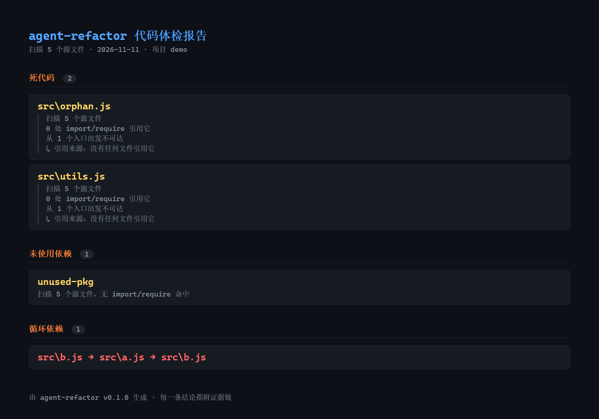

# agent-refactor

> **别再手动排雷了。** 一键给代码库做微创手术：自动清掉没人用的死代码和依赖，删之前先备份、删完自动跑测试，崩了自动还原——每一步都有证据链，不让你背锅。

不是"告诉你哪里臭"，而是"告诉你这行代码为什么没人用、这块 UI 为什么拆不动，然后安全地清掉或拆开它"。

## 演示


终端里扫完，浏览器里直接生成 HTML 体检报告——每条死代码都带引用链和置信度，截图如下（[下载 mp4](docs/demo/demo.mp4)）：



## 它做什么

四条命令，覆盖"体检 → 修复 → 重构"完整链路：

| 命令 | 作用 | 输出 |
| --- | --- | --- |
| `scan` | 扫描死代码 / 未用依赖 / 循环依赖 | 终端报告 + HTML，每条结论带证据链（扫描文件数、引用链、可达性）与置信度（high / medium / low） |
| `fix` | 安全清理：备份 → 删除/清理 → 跑测试 → 通过保留 | 失败自动回滚，零残留 |
| `split` | 把巨型组件拆成子组件 + hooks：分析 → 规划 → 生成 → 门禁 → 落地 | 拆分后的文件树 + 门禁日志 |
| `analyze` | 对任意组件只出拆分计划，不落地 | 语义地图 + 拆分计划 |

## 支持矩阵

| 能力 | React / TSX | Vue SFC | Svelte | 纯 JS/TS | 后端 Node |
| --- | --- | --- | --- | --- | --- |
| 静态扫描：死代码 / 未用依赖 / 循环依赖 | ✅ | ✅ | ✅ | ✅ | ✅ |
| 自动拆分（LLM 规划 → 生成 → 构建/回归门禁） | ✅ | ✅（静态回归） | ❌ | ❌ | ❌ |

- **scan** 是通用静态分析：多框架、单文件组件、后端脚本都能扫。
- **split 自动重构**目前只覆盖组件化前端（React/Vue）：后端和普通 JS 给扫描与建议，不自动重构。
- 拆分后的验证：项目有构建/测试就跑真门禁；没有就退回语法检查 + 静态结构回归，并明确标注「未做行为等价证明」。

## 这个工具能帮你解决什么麻烦？

**接手了别人的代码，不敢删任何文件？** 最怕一删就崩、锅是自己的。`scan` 跑一遍，列出没人引用的死代码和没用的依赖，每条结论带证据链（扫了多少文件、谁引用它、从入口能不能走到）；拿不准先 `--dry-run` 看计划，确认了再修——`fix` 会先备份、删完跑测试，测试挂了自动还原，不让你背锅。

**重构完一地鸡毛，遗留一堆垃圾？** 接进 GitHub Action，每次推 PR 自动扫一遍，把这次新冒出来的死代码直接评论在 PR 里，合并前自己看清。

**技术主管没空逐个审查？** 定期跑一次，看哪些模块已经变成"无人问津的孤岛"——没人引用、没人 import、只在 git 历史里活着。

## 实测数据（真实，可复核）

**巨型组件拆分**（fixtures/giant-app，550 行 Dashboard）：

- 550 行单文件 → 119 行容器 + 6 个子组件 + 3 个 hooks + 共享类型
- 门禁：vite 构建通过（1648ms 首次 / 479ms 缓存）、SSR 冒烟通过（HTML 1346 字符）、单元测试 14 个全绿
- jsdom 交互冒烟：初始渲染、筛选面板展开、新增弹窗开关 4 步通过
- 失败案例：第一次生成编译失败，门禁拦截、自动回滚、零残留（见 [案例](docs/case-study/README.md)）

**真实开源仓库端到端**（ant-design-pro v6.0.3，真实生产级 umi 项目，页面组件 advanced-form 554 行）：

- 第一次尝试：生成代码把 JSX 写进 `.ts` hook 文件，构建失败 → 门禁拦截、自动回滚、零残留（已修复空目录残留）
- 修复引擎后重跑：554 行 → 58 行容器 + 4 组件 + 1 hook，`npm run build` 通过（17 秒）、`tsc --noEmit` 通过
- 这不是自建 fixture，是真实开源仓库的完整构建验证

**真实开源组件**（ant-design/ant-design `components/table/InternalTable.tsx`，822 行）：

- 分析出 47 个状态、20 个 UI 区块、12 个副作用、3 处强耦合（changeEventInfo 共享对象、transformColumns 链、mergedData 依赖链）
- 规划 3 组件 + 5 hooks + 7 步迁移，结构校验通过
- 局限：该文件依赖 30+ 内部模块，只能验证规划质量，未能构建验证（见边界）

**扫描精度**（2026-11 修复）：入口可达性 + 置信度分级后，real-repo 死代码 108 → 14，旧报告 100 条误报抽检 0 条仍是 high；mini-leads 旧报告 4 条误报全部降级；giant-app 0 条 high。fix 只删 high 置信死文件。

**真实仓库回归语料**（2026-11-12，六个真实开源仓库 `git clone --depth 1` 后裸跑，可用 `npm run corpus` 复现）：

| 仓库 | 扫描文件 | 死代码（high/medium） | 未用依赖 | 说明 |
| --- | --- | --- | --- | --- |
| unjs/ofetch | 19 | 0 / 0 | 0 | examples/ 是入口；`--coverage`/`provider` 推断 coverage 包、automd 文档标记不算未用 |
| vuejs/create-vue | 101 | 0 / 68 | 0 | 68 条全是 template/ 下的模板片段（生成器复制出去的资源），标 medium 不删；模板包依赖不检查 |
| unplugin/unplugin-auto-import | 114 | 1 / 0 | 1 | 唯一 high 是 `src/presets/preact-compat.ts`，全仓库确实零引用；唯一未用依赖 `@svgr/plugin-jsx` 全仓库零引用，是真·遗留 |
| honojs/hono | 454 | 0 / 0 | 0 | TS monorepo；`.mts` 全量扫描、benchmarks 是入口、CI workflow 点名的包（pkg-pr-new 等）算用到 |
| vuejs/pinia | 168 | 0 / 8 | 1 | pnpm monorepo；`.vitepress` 与 nuxt `runtime/` 按约定降级、`*.test-d.ts` 当测试入口、playground 的 URL 字符串引用降 medium；剩 `pascalcase` 是真遗留 |
| expressjs/express | 140 | 0 / 0 | 1 | 纯 CJS 老仓；`hbs` 只在 examples 里当 view engine，属示例依赖 |

这一轮修掉的现实问题：monorepo 每个包的框架路由目录、Astro/Svelte 文件解析、配置里 `dirs: ['src/views']` 式自动导入目录、`dist/x.mjs` 导出回推 `src/x.ts` 源码入口、tsconfig `extends`/脚本 CLI/配置字符串里的依赖不算未用；templates/examples/playground/benchmarks 包是交付给用户的资源包不做依赖检查；脚本里的 CLI 别名（`nr`→@antfu/ni、`run-p`→npm-run-all2、`tsgo`→native-preview、`nuxt-module-build`→@nuxt/module-builder）映射到真实包；vitest coverage 按 `--coverage` 与 `provider` 推断缺的包；`.mts/.cts` 全量扫描、VitePress `.vitepress` 入口、Nuxt 模块 `runtime/` 约定、`*.test-d.ts` 类型测试入口、config 模板字符串（`` `./src/${name}.js` ``）按通配展开、`.d.ts` 声明文件不判 high、`simple-git-hooks` 入口、CI workflow 里点名的依赖、`--ui`→@vitest/ui 这几类也都补上了。

**成本**：单组件完整拆分（分析 + 规划 + 生成，共 3 次 LLM 调用）约 2–3 万 token，按 DeepSeek 价格约 **3–5 分钱**；失败回喂修复每轮再加约 3 千 token。样本与记录见 `memory/audit/split-engine-2026-11-15.md`。

**量化与公开评测**：本地基准 `node scripts/bench.mjs`（real-repo 391 文件 / 417ms / 死代码 14 / 未用依赖 2），历史 SWE-bench 47/47 补丁验证与 τ-bench retail 71.3% 等数据（含污染与口径限制）见 [benchmark/](benchmark/)。测试覆盖率 `npm run coverage`：行 94.25% / 分支 81.93% / 函数 87.81%。扫描范围可观测：被排除目录、未扫描文件、解析失败的相对 import 逐条写进 meta；动态 import 模板命中的文件降级并给证据（对抗语料 `fixtures/adversarial`）。

## 诚实边界（先看这里）

1. **行为等价性机器证明不到 100%。** 门禁能证明"能编译、结构等价、现有测试通过"，但异步、动画、副作用类组件的真实行为必须人工回归——这是物理上限，不是没做。
2. **真实仓库构建验证已做一次**（ant-design-pro advanced-form 页面，构建+类型检查通过）；antd 的 822 行 InternalTable 只验证了规划质量，因为依赖 30+ 内部模块无法独立构建。
3. **LLM 生成是非确定性的。** 同一组件两次拆分结果可能不同；工具记录每次的模型版本与成本，便于审计。
4. **验证等级标注**：每条结论都会标注「编译级 / 结构级 / 行为级」，行为级不承诺，只标注。
5. **动态加载摸不到。** 靠 resolver 自动导入的包（如 element-plus、@iconify-json/*）、生成器运行时拼接的模板路径，静态图里没有引用边：前者可能仍出现在「未用依赖」，后者一律降为 medium 不自动删。
6. **examples / templates 走约定而非引用。** examples、playground、demo 目录按入口处理；templates 目录按「复制出去的资源」标 medium——真实删除前请人工确认。
7. **扫描器定位**：`scan` 是自研轻量解析，成熟度不如 knip / putout 这类专职静态工具；如果目标只是找未用代码，用 knip 更稳。本项目真正价值在「扫描结果 → AI 安全重构 → 门禁回滚」这条链，不在单点扫描精度。

## 安全保证

- **fix / split 永远先备份**：被改文件先复制到系统临时目录（`mkdtemp` 的 `agent-refactor-*`），成功后清理，失败自动回滚。
- **门禁自动判定**：fix 跑 `testCommand`，split 跑 `buildCommand` + 可选 `verifyCommand`（如 SSR 冒烟）。
- **失败自动回滚**：门禁不过，恢复全部文件，报告原始错误。
- **默认 dry-run**：`--yes` 显式同意才落地；没测试命令默认拒绝修复。
- **生成代码安全审查**：split 落盘前扫生成代码红线（eval / new Function / child_process / document.write），命中回喂模型重生成一次，仍命中拒绝落盘；dangerouslySetInnerHTML / innerHTML / 硬编码密钥只记警告。

## 快速开始

最快的方式是直接跑自带的演示项目，十秒看到结果：

```bash
# 一次性准备
git clone https://github.com/Hayabusa-YL/dsh-agent-refactor.git
cd dsh-agent-refactor && npm install

# 对着演示项目跑一遍（扫描 5 个文件，附死代码 / 未用依赖 / 循环依赖）
node bin/cli.js scan fixtures/demo-project
```

正式使用（在你要体检的项目里）：

```bash
node bin/cli.js scan .
node bin/cli.js fix . --dry-run   # 先看计划，确认后再加 --yes
node bin/cli.js analyze fixtures/real-components/antd-InternalTable.tsx   # 需配 LLM
node bin/cli.js split fixtures/giant-app/src/App.tsx --yes               # 需配 LLM
node bin/cli.js batch . --dry-run                                       # 批量列出大组件拆分计划（--yes 才应用）
```

> 已发布到 npm：`npx agent-refactor scan ./你的项目` 一行搞定（无需 clone 和 install）。

LLM 配置（环境变量）：

```bash
export AGENT_REFACTOR_LLM_BASE_URL=https://api.deepseek.com/v1
export AGENT_REFACTOR_LLM_KEY=sk-***
export AGENT_REFACTOR_LLM_MODEL=deepseek-chat
```

## 作者与来历

这整个项目——代码、测试、审计记录、失败复盘——由 AI agent 在一位人类的指令下完成。人负责下指令和决策，AI 负责全部实现与验证。这本身就是作品的一部分：一个能独立交付、知道何时停手、诚实标注上限的 AI 工程师。

## 至臻门禁

报「完成」前先跑 `npm run gate`——一条命令把全部已知验收点过一遍，全 PASS 才允许汇报：

```bash
npm run gate
```

检查项：全量测试（含拆分行为快照真环境验证）、real-repo 语料基线（未用依赖 ≤2、high 死代码不倒退、react-dom / biome / commitlint / workers-types 四类已知误报零回归）、CLI 冒烟（scan --json 可解析）、文档与版本同步。任一 FAIL 退出非 0，适合挂 CI 或 pre-push。

## 路线图

- [x] scan：死代码 / 未用依赖 / 循环依赖 + 证据链
- [x] fix：备份 + 测试门禁 + 自动回滚
- [x] split：LLM 分析 → 规划 → 生成 → 门禁（构建 / 快照 / 测试）→ 回归
- [x] analyze：任意组件出拆分计划
- [x] 真实组件对照（antd InternalTable 规划验证）
- [x] 生成代码静态安全审查（eval/new Function/child_process/document.write 红线，命中回喂重生成）
- [x] 批量拆分：扫全项目巨组件，逐个拆，单个失败不阻断后续
- [x] 真实仓库端到端构建验证（ant-design-pro advanced-form，构建 + 类型检查通过）
- [x] GitHub Action：PR / push 自动体检评论（.github/workflows/self-scan.yml）
- [x] 真实仓库回归语料（create-vue / ofetch / unplugin-auto-import，`npm run corpus` 复现）
- [x] Vue SFC 拆分支持（analyze/plan/generate 按 .vue 走 Vue 专用路线）
- [x] 无构建脚本兜底（node --check 语法检查 + 静态结构回归）
- [x] gate 挂进 CI（self-scan workflow 增加 gate job）
- [x] 公开量化 benchmark（scripts/bench.mjs：耗时 / 文件数 / 死代码 / 未用依赖 / 循环依赖）
- [x] VSCode 插件最小版（命令面板一键体检，诊断标在编辑器）
- [x] 公开评测历史归档（benchmark/：SWE-bench 补丁验证 + τ-bench，含口径限制）
- [x] 对抗性语料（fixtures/adversarial：动态 import / 别别名 / 条件导出 / 真死文件）
- [x] 覆盖率量化（npm run coverage：行 94.25% / 分支 81.93%）
